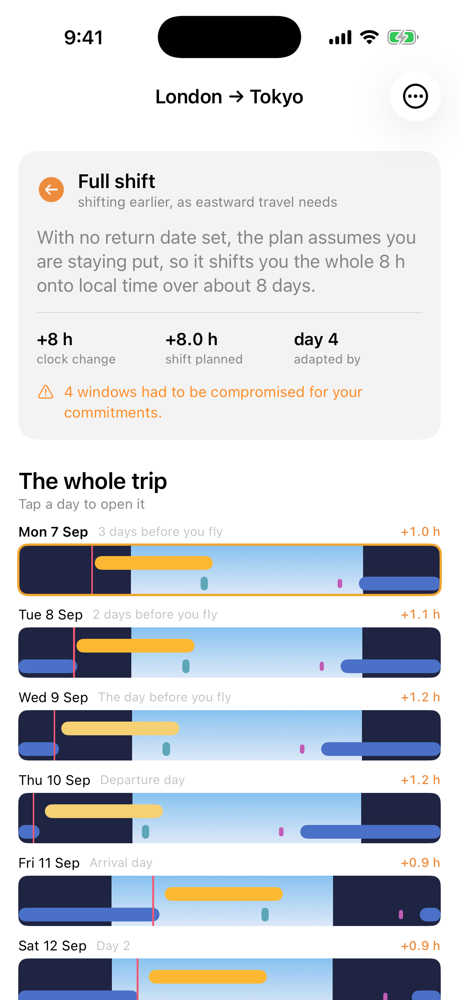
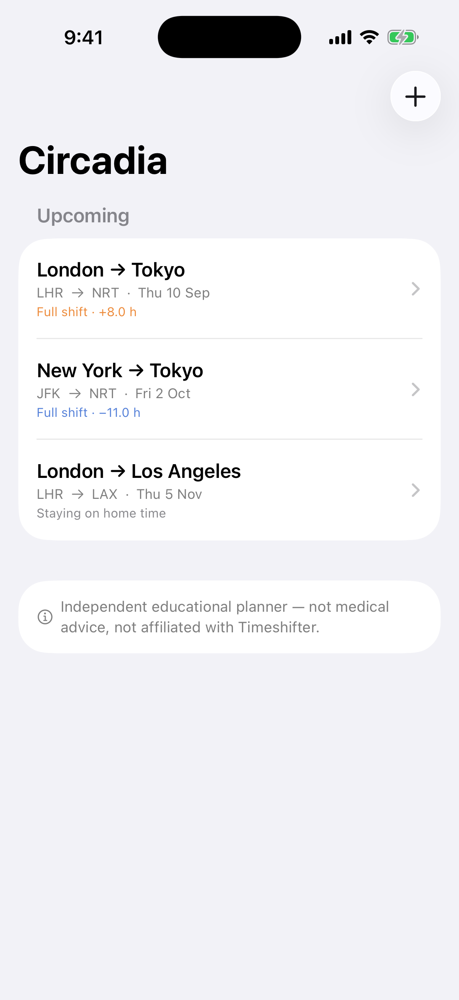
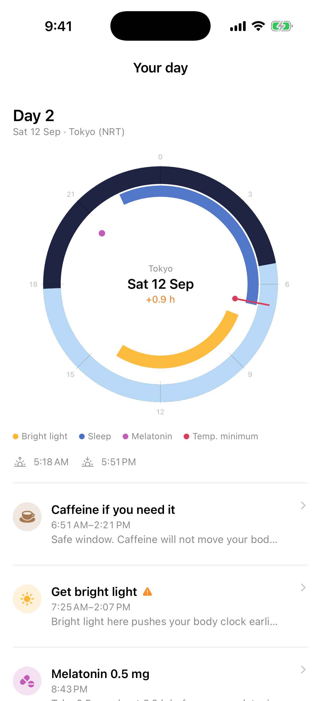
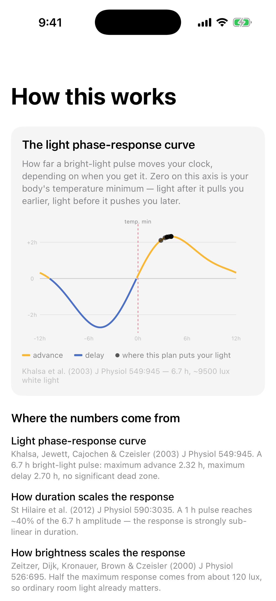
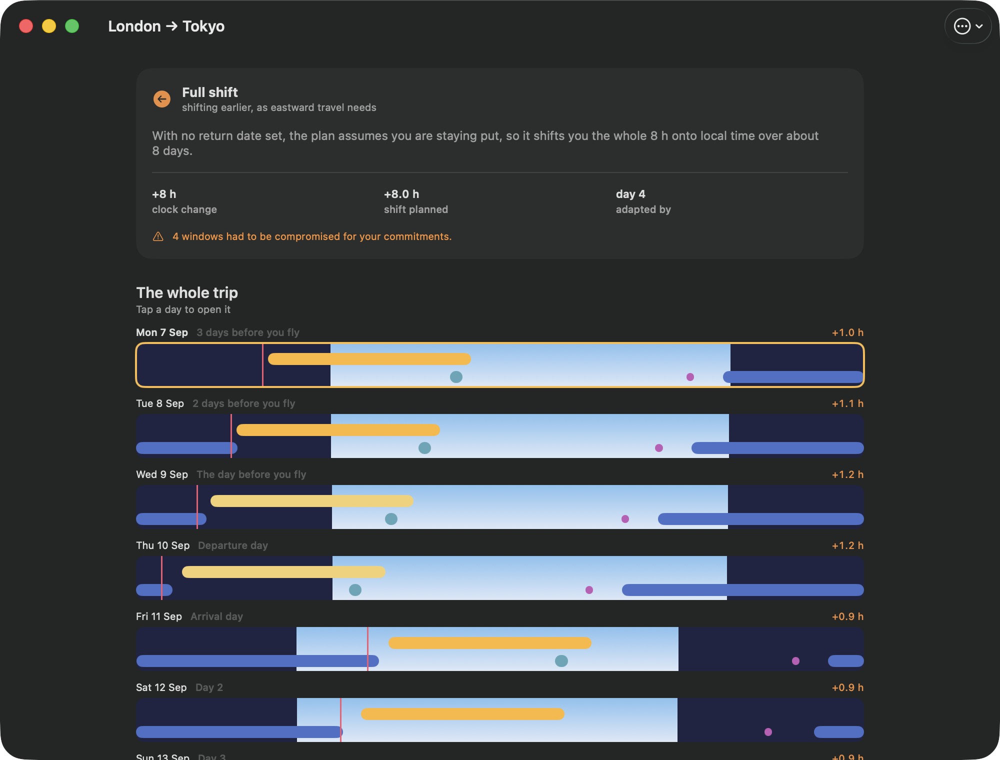

# Circadia

[](https://github.com/luca-fogel/circadia/actions/workflows/ci.yml)

An hour-by-hour jet-lag plan, built from the published circadian literature.

A native **iOS and macOS** app in Swift and SwiftUI. Give it a flight, your usual
sleep times and five questions about your body clock, and it returns a plan from
a few days before departure until you have adapted: when to get bright light,
when to avoid it, when to sleep, when a melatonin dose would help, and when to
stop drinking coffee. Everything runs on device — no account, no server, no key.



> **Status: built and working, not released.** It is not on the App Store, there
> are no users, and there are no download numbers to quote. It runs on my phone
> and on my Mac, and it will run on yours in about two minutes.

> [!IMPORTANT]
> **This is an educational tool, not medical advice**, and it is **not affiliated
> with, endorsed by, or derived from Timeshifter** or any commercial jet-lag
> product. Their algorithm is proprietary and unpublished; this is an independent
> reimplementation from public papers, written to be read and checked. Melatonin
> is a prescription medicine in some countries and is not suitable for everyone.

It started as a deliberately minimal recreation of a jet-lag app — a fixed
"shift one hour per day" ramp and a plain form. The interesting question turned
out to be the one that replaced it: **how much of a personalised circadian plan
can you actually rebuild from the published literature alone?** Quite a lot, as
it happens, and the places where the papers refuse to cooperate are the most
interesting part of the repository. Those are all written up in
[DEVIATIONS.md](DEVIATIONS.md).

## What it does differently

The usual approach is to ramp the schedule at a fixed rate and hang the light
windows off your home wake time. This simulates the pacemaker forward, one day at
a time:

```
     your habitual sleep + chronotype
                  │
                  ▼
    estimated temperature minimum ─────────────┐
                                               │  for each day:
     flight, real IANA time zones              │
                  │                            ▼
                  ▼                   ┌──────────────────────┐
        how far to shift, and          │ aim a light window at │
        whether it is worth it   ────► │ the phase-response    │
                  │                    │ curve's peak          │
                  │                    ├──────────────────────┤
                  │                    │ size it from the      │
     sunrise / sunset at both ends ───►│ dose–response law     │
                  │                    ├──────────────────────┤
     your real commitments ───────────►│ bend it around the    │
                  │                    │ sun and your diary    │
                  │                    ├──────────────────────┤
                  │                    │ ask the curve how far │
                  ▼                    │ the clock moved       │
             the plan  ◄───────────────┴───────────┬──────────┘
                                                   │ step forward a day
                                                   └──────────►
```

**The pace of adaptation is an output, not an assumption.** A pleasing check on
that: Khalsa's published curve amplitudes, scaled by a 50% real-world compliance
assumption and combined with the drift of a ~24.15 h intrinsic period, reproduce
the clinical rules of thumb — about 1 h/day of advance and 1.5 h/day of delay —
with neither figure hardcoded anywhere. There is a test asserting exactly that.

Taking the model seriously has consequences:

- **Direction is chosen by cost, not by compass.** A 13-hour eastward hop —
  New York to Tokyo — is planned as an **11-hour delay**, because delaying 11 h at
  ~1.5 h/day beats advancing 13 h at ~1 h/day. The app says so, in words, rather
  than leaving you to assume it is a bug.
- **Sometimes the right answer is not to shift at all.** If you would still be
  mid-adaptation when it is time to fly home, and would then have to undo it, the
  plan keeps you on home time and expresses your home sleep window in destination
  local time.
- **Light windows respect the actual sun.** Sunrise and sunset are computed on
  device from the airport's coordinates. "Get bright light" is never scheduled
  into the dark; when the physiological optimum genuinely falls at night, the
  advice downgrades to a lamp and the predicted effect is recalculated at the
  lower illuminance.
- **Your commitments are honoured, and their cost is reported.** Tell it you
  cannot avoid light during a conference and it stops giving you impossible
  instructions, offers mitigation instead, and *subtracts the shift you lose* from
  that day's progress rather than pretending the day went to plan.

## The screens

| | | |
|:--:|:--:|:--:|
|  |  |  |
| **Trips** — three itineraries, three different strategies | **Your day** — a 24-hour dial: daylight, sleep, light windows and your temperature minimum | **How this works** — the actual curve, with dots where this plan put your light |

A circadian day *is* a cycle, so the dial shows one more truthfully than a bar
would: the relationship between your temperature minimum, the night and the light
windows is an angular one, and on a ring you can see all of it at once without a
seam through the middle of the night. The stack of ribbons on the plan screen is
the other half of that — it is for scanning a whole trip, where the sleep block
walking steadily across the strip is the clearest picture of what the plan is
doing to you.

Every screenshot here is generated by `tools/screenshots.sh` from a clean
simulator. Nothing is mocked up in a design tool and nothing is hand-edited; the
plans in them are produced by the real engine from the itineraries in
`DemoScreens.swift`.

## It runs on macOS too



One multiplatform target, not a stretched phone app: on the Mac the dial sits
beside the day's instructions instead of below them, because there is room.
`tools/screenshot-mac.sh` builds it, runs it and captures it.

## Run it

Requires **Xcode 16 or later** (developed against Xcode 26) and Swift 6.

```sh
git clone https://github.com/luca-fogel/circadia.git
cd circadia
open Circadia.xcodeproj      # then ⌘R on My Mac or any iOS simulator
```

There is nothing to configure and no key to paste. To run it on a phone, put your
Apple Developer team in `Local.xcconfig`:

```sh
echo 'DEVELOPMENT_TEAM = YOURTEAMID' > Local.xcconfig
```

then pick your device and ⌘R. On the first install, approve the certificate on
the phone under **Settings → General → VPN & Device Management**.

### The engine, without Xcode

The model is a plain Swift package with no UI dependencies, so it tests in about a
tenth of a second with no simulator involved:

```sh
swift test --package-path Packages/CircadianKit    # 57 tests
tools/check.sh                                     # what CI runs
```

Coverage includes multi-day eastward and westward trips, a no-op short hop, a
trip that crosses a daylight-saving transition, a quick-turnaround trip, the
phase-response curve's published landmarks, the solar calculations, and the
practicality filter.

## Where the numbers come from

Every one of these is cited in the source at the point of use, and surfaced in the
app under **How this works**, because advice you cannot check is not much better
than superstition.

| Quantity | Source |
| --- | --- |
| Light phase-response curve | Khalsa, Jewett, Cajochen & Czeisler (2003) *J Physiol* 549:945 — 6.7 h at ~9500 lux: max advance +2.32 h at circadian phase 4.05 h, max delay −2.70 h at 19.38 h, peak-to-trough 5.02 h, and **no significant dead zone** |
| How duration scales it | St Hilaire et al. (2012) *J Physiol* 590:3035 — a 1 h pulse gives 2.20 h peak-to-trough, ~40% of the 6.7 h amplitude from 15% of the exposure. Solving `(1/6.7)^p = 2.20/5.02` gives the exponent p ≈ 0.434 |
| How brightness scales it | Zeitzer, Dijk, Kronauer, Brown & Czeisler (2000) *J Physiol* 526:695 — half-maximal near ~120 lux, so ordinary room light already matters |
| Melatonin phase-response curve | Burgess, Revell & Eastman (2008) *J Physiol* 586:639; Burgess et al. (2010) *JCEM* 95:3325 |
| Temperature minimum ↔ wake, by chronotype | Duffy, Rimmer & Czeisler (2001); Duffy et al. (1999) |
| Melatonin onset → temperature minimum ≈ 7 h | Burgess et al. (2003) |
| Intrinsic period ≈ 24.15 h | Czeisler et al. (1999) |
| Sunrise and sunset | NOAA Solar Calculator, after Meeus, *Astronomical Algorithms* |
| Airports, coordinates and IANA zones | [mwgg/Airports](https://github.com/mwgg/Airports) |

Neither PRC paper publishes its fitted coefficients, so `DualHarmonicPRC` recovers
them by solving the small linear system that forces the paper's own functional
form — a dual-harmonic sinusoid — through the published extrema as stationary
points. That reproduces the published maxima exactly; tests assert it does not
overshoot them.

## Layout

```
Packages/CircadianKit/          the model. Foundation only, no UI, 57 tests
  Sources/CircadianKit/
    Core/                       24 h modular arithmetic, chronotype, phase state
    PRC/                        the curves, the dose–response laws, the estimator
    Solar/                      NOAA/Meeus solar position
    Places/                     7,743 airports, offline, ranked search
    Planning/                   strategy, the day-by-day simulation, window placement
App/Circadia/
  Model/                        SwiftData persistence
  Services/                     notifications, optional location
  Onboarding/                   six-step questionnaire
  Timeline/                     the dial, the ribbons, the curve
  Support/                      theme, disclaimer and citations
tools/                          check.sh, screenshots.sh, screenshot-mac.sh
project.yml                     XcodeGen spec; the .xcodeproj is generated from it
DEVIATIONS.md                   every place the model departs from the obvious choice
```

`project.yml` is the source of truth for the project file. The generated
`.xcodeproj` is committed so that cloning and opening just works; if you change
the target layout, `brew install xcodegen && xcodegen generate`.

## Non-goals

No accounts, no login, no payments, no backend, no analytics. The airport
database, the solar calculations, the plan and the notifications all run on
device. The only network-capable component is an optional CoreLocation lookup that
resolves to a bundled airport and stores nothing — decline it and the app is
unaffected.

## Contributing

See [CONTRIBUTING.md](CONTRIBUTING.md). The engine is the part most likely to have
a bug you have hit too, and it is the part you can test in a tenth of a second.

## Licence

[GPL-3.0](LICENSE). Timeshifter is a trademark of Timeshifter, Inc.; this project
is not affiliated with them.
